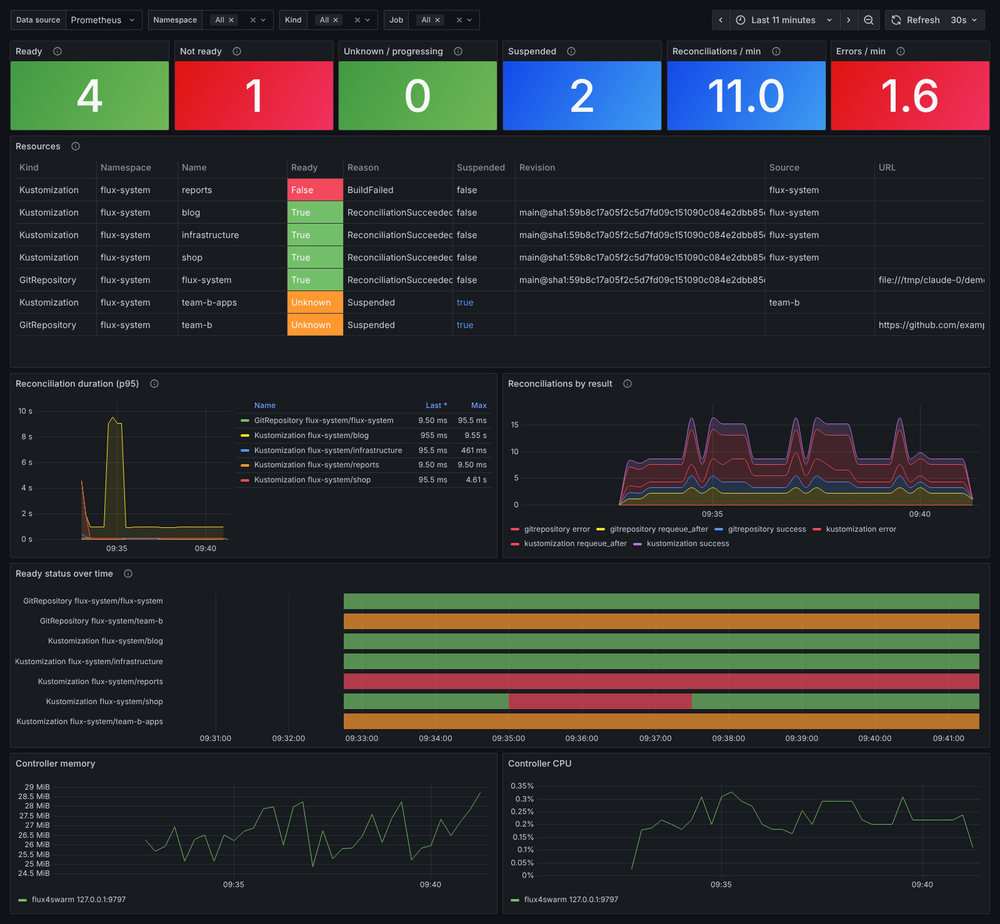

# Monitoring

The controller serves Prometheus metrics on `/metrics` of its status port
(`:9797`). The names and labels are the ones the Flux controllers export,
plus the `gotk_resource_info` series that the
[flux2-monitoring-example](https://github.com/fluxcd/flux2-monitoring-example)
kube-state-metrics configuration produces on Kubernetes. One Grafana dashboard
and one set of alerts therefore cover Flux on Kubernetes and flux4swarm on
Swarm.



## Metrics

| Metric | Type | Labels | Flux source |
|--------|------|--------|-------------|
| `gotk_resource_info` | gauge, always 1 | `customresource_group`, `customresource_kind`, `customresource_version`, `exported_namespace`, `name`, `ready`, `reason`, `suspended`, `revision`, `url` (GitRepository), `source_name` (Kustomization) | kube-state-metrics custom resource config of flux2-monitoring-example |
| `gotk_reconcile_duration_seconds` | histogram | `kind`, `name`, `namespace` | `fluxcd/pkg/runtime/metrics`, same buckets |
| `gotk_reconcile_condition` | gauge | `kind`, `name`, `namespace`, `type="Ready"`, `status` (`True`, `False`, `Unknown`) | `fluxcd/pkg/runtime/metrics` (deprecated in Flux 2.1, kept for older dashboards) |
| `gotk_suspend_status` | gauge | `kind`, `name`, `namespace` | `fluxcd/pkg/runtime/metrics` (deprecated in Flux 2.1) |
| `controller_runtime_reconcile_total` | counter | `controller` (`gitrepository`, `kustomization`), `result` (`success`, `error`, `requeue_after`) | controller-runtime |
| `controller_runtime_reconcile_errors_total` | counter | `controller` | controller-runtime |
| `controller_runtime_reconcile_time_seconds` | histogram | `controller` | controller-runtime |
| `controller_runtime_max_concurrent_reconciles` | gauge | `controller` | controller-runtime |
| `go_*`, `process_*` | | | Prometheus Go client |

Results follow what the Flux reconcilers return to controller-runtime: a
successful reconcile or one waiting for `dependsOn` requeues after the
interval (`requeue_after`), a failure is an `error`, and a suspended object
returns `success`. Suspended objects record no `gotk_reconcile_duration_seconds`.

On Kubernetes, Prometheus renames the `namespace` label of controller metrics
to `exported_namespace` because the scrape adds the pod's namespace. On Swarm
the label stays `namespace`. The dashboard below handles both.

## import --watch

`flux4swarm import --watch` retries failed exports forever, so it runs
unattended but would otherwise fail silently (an expired Git token, a
rejected push, Docker API errors). It serves its own endpoints on `--listen`
(default `:9797`, empty disables them):

| Endpoint | |
|----------|-|
| `GET /healthz` | 200, or 503 with the reason and last error once no export succeeded for `--unhealthy-after` (default 3 x `--interval`, so 30m); before the first success the time since start counts |
| `GET /readyz` | 503 until the first successful export |
| `GET /status` | JSON: `healthy`, `lastAttempt`, `lastSuccess`, `lastCommit`, `lastCommitTime`, `lastError`, `consecutiveFailures` |
| `GET /metrics` | the metrics below, plus `go_*` and `process_*` |

| Metric | Type | Labels | Meaning |
|--------|------|--------|---------|
| `flux4swarm_watch_healthy` | gauge | | 1 when `/healthz` passes |
| `flux4swarm_watch_syncs_total` | counter | `result` (`success`, `error`) | exports, including the cheap ones that find nothing changed |
| `flux4swarm_watch_consecutive_failures` | gauge | | failed exports since the last success |
| `flux4swarm_watch_commits_total` | counter | | commits pushed to Git |
| `flux4swarm_watch_last_success_timestamp_seconds` | gauge | | Unix time of the last successful export (0 before it) |
| `flux4swarm_watch_last_attempt_timestamp_seconds` | gauge | | Unix time of the last export |
| `flux4swarm_watch_last_commit_timestamp_seconds` | gauge | | Unix time of the last push |
| `flux4swarm_watch_last_commit_info` | gauge, always 1 | `commit` | the last commit pushed |
| `flux4swarm_watch_unhealthy_after_seconds` | gauge | | the `--unhealthy-after` limit |

The distroless image has no shell or curl for a Docker `HEALTHCHECK`, and a
restart would not fix an expired token anyway, so alert on the metrics
instead (see [Alerts](#alerts)).

## Grafana dashboard

[deploy/monitoring/grafana/flux-gitops.json](../deploy/monitoring/grafana/flux-gitops.json)
shows ready, failing and suspended resources, a table of every GitRepository
and Kustomization with its revision and reason, reconcile duration, reconcile
results, Ready status over time and the controller's CPU and memory. It uses
only metrics both platforms have, so point it at a Prometheus that scrapes
Flux on Kubernetes (with the kube-state-metrics config of
flux2-monitoring-example), flux4swarm, or both, and filter with the
namespace and kind variables.

## Running it on Swarm

[deploy/monitoring/monitoring-stack.yaml](../deploy/monitoring/monitoring-stack.yaml)
runs Prometheus and Grafana with the dashboard provisioned. It expects the
controller of [deploy/flux4swarm-stack.yaml](../deploy/flux4swarm-stack.yaml)
in stack `flux-system` and scrapes it over that stack's network:

```sh
docker config create prometheus.yml deploy/monitoring/prometheus.yml
docker config create grafana-datasource deploy/monitoring/grafana/provisioning/datasources/prometheus.yaml
docker config create grafana-dashboards deploy/monitoring/grafana/provisioning/dashboards/flux.yaml
docker config create grafana-flux-gitops deploy/monitoring/grafana/flux-gitops.json
docker stack deploy -c deploy/monitoring/monitoring-stack.yaml monitoring
```

Prometheus also loads the example [alerts](#alerts). To scrape
`import --watch` of
[deploy/flux4swarm-export-stack.yaml](../deploy/flux4swarm-export-stack.yaml)
(stack `flux4swarm-export`) too, uncomment the `flux4swarm-export` network in
the monitoring stack; the `flux4swarm-export` job finds it as `tasks.export`.

To use an existing Prometheus instead, add a scrape job for port `9797` of the
controller (and of `import --watch`), for example with `dns_sd_configs` on
`tasks.controller` as in
[deploy/monitoring/prometheus.yml](../deploy/monitoring/prometheus.yml), load
[deploy/monitoring/alerts.yml](../deploy/monitoring/alerts.yml) with
`rule_files`, and import the dashboard JSON in Grafana.

## Alerts

[deploy/monitoring/alerts.yml](../deploy/monitoring/alerts.yml) has example
Prometheus rules. They expect the job names of
[deploy/monitoring/prometheus.yml](../deploy/monitoring/prometheus.yml)
(`flux4swarm` for the controller, `flux4swarm-export` for `import --watch`);
send them on with your Alertmanager.

| Alert | Fires when | Severity |
|-------|------------|----------|
| `Flux4SwarmWatchUnhealthy` | `flux4swarm_watch_healthy == 0` for 5m: no successful export for `--unhealthy-after` | critical |
| `Flux4SwarmWatchFailing` | 3 or more exports in a row failed, for 15m | warning |
| `Flux4SwarmWatchDown` | the `import --watch` target is down for 10m | critical |
| `FluxReconciliationFailure` | a GitRepository or Kustomization is not Ready for 10m (the Flux rule, works on Kubernetes too) | warning |
| `FluxResourceStale` | an object that is not suspended was not reconciled for an hour | warning |
| `FluxResourceSuspended` | an object has been suspended for a day | info |
| `FluxControllerDown` | the controller target is down for 5m | critical |

`FluxResourceStale` assumes intervals under an hour; widen its window if you
use longer ones. `up == 0` does not fire when a service is removed
altogether; add `absent(up{job="..."})` if that matters to you.
