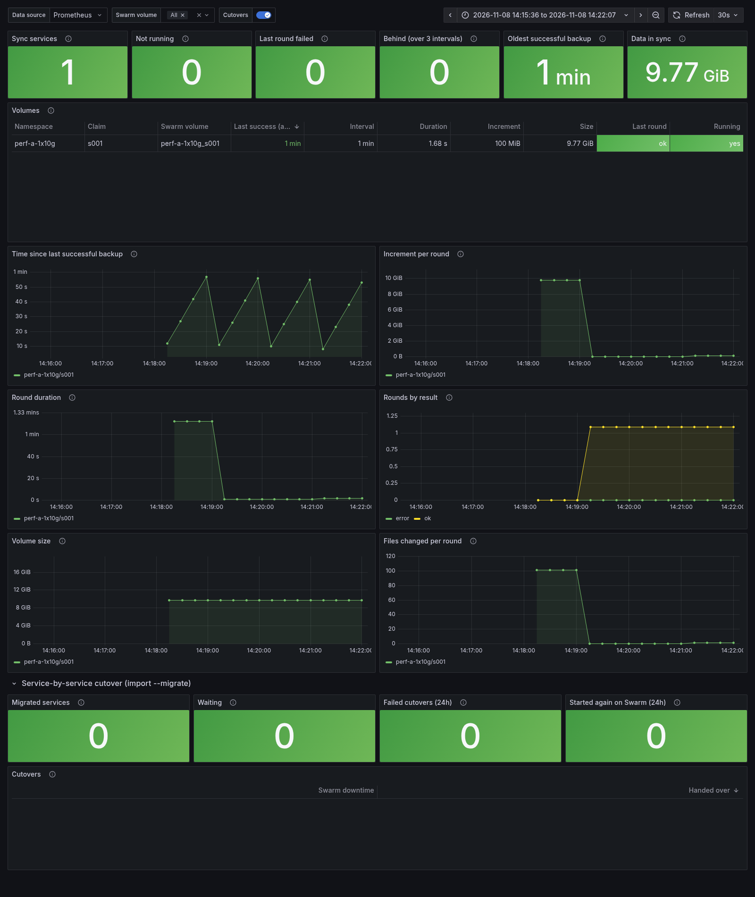
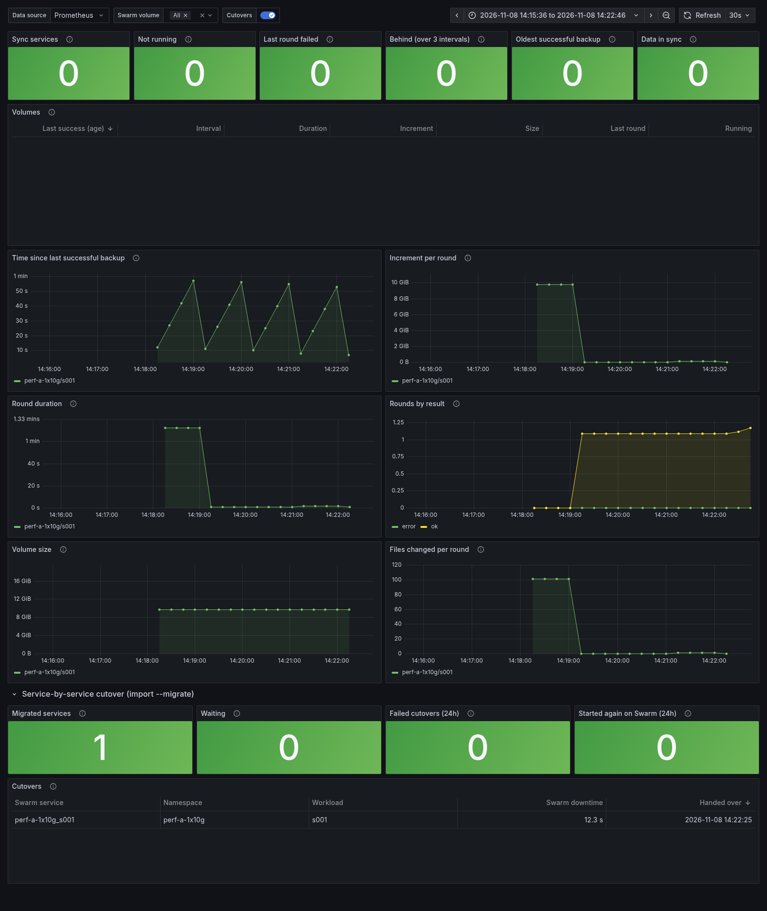
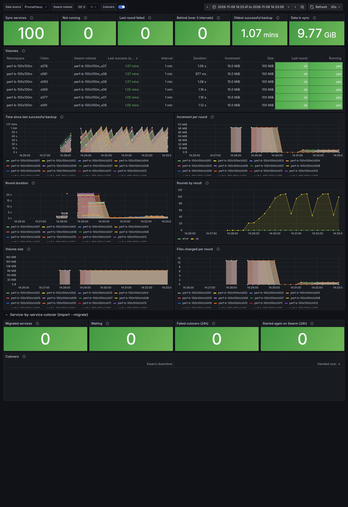
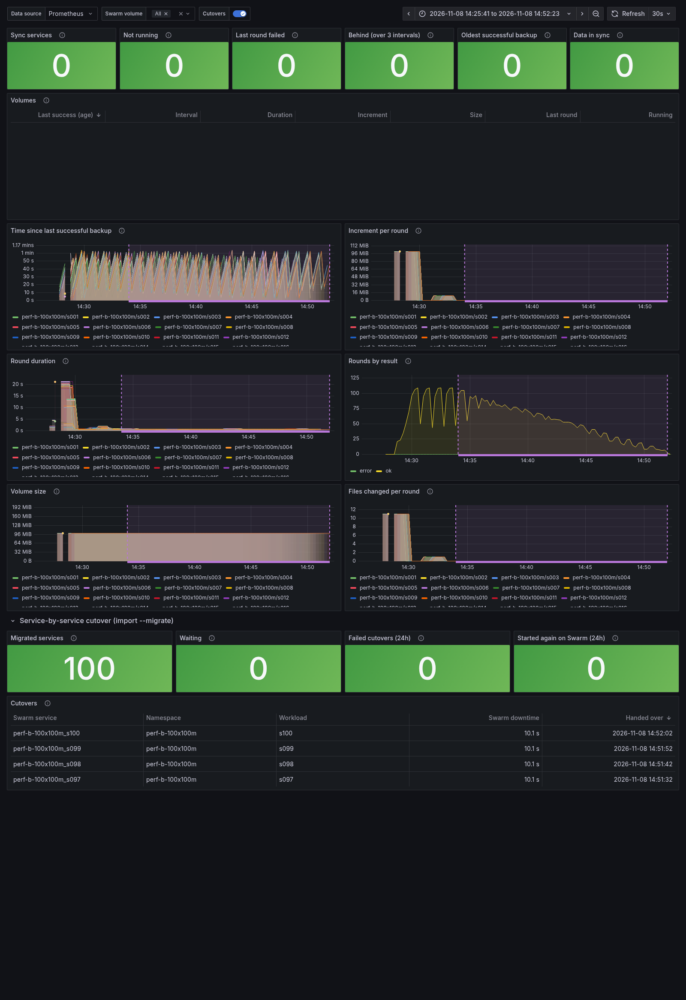

# Volume data sync performance

Measured on 2026-11-08 on the [development server](development-server.md):
how long it takes to copy Swarm volume data to Kubernetes with
`flux4swarm volume-backup` / `import --volsync-sync` (restic) and VolSync,
for one large volume and for many small ones, and how much faster the
increments are than the first copy.

These are benchmarks, not tuning: everything ran with the defaults. The
raw numbers are in [benchmarks/2026-11-08](benchmarks/2026-11-08), and the
scripts that produced them are in [test/perf](../test/perf).

## Summary

| | A: 1 volume x 10 GB | B: 100 volumes x 100 MB |
|---|---|---|
| First full backup, one-shot `volume-backup` | 140-162 s | 820 s one volume at a time, 245 s with 10 at a time |
| First full round of the sync services (`--volsync-sync`) | 72 s | 141 s for all 100 (they run at once) |
| First full restore on K3s (VolSync) | 69-83 s | 443 s |
| **+1 MB per volume: backup + restore** | **6 s + 51 s = 57 s** | **98 s + 43 s = 141 s** |
| **Speed-up of the 1 MB increment over the first copy** | **3.9x** (backup 23x, restore 1.6x) | **4.9x** (backup 2.5x, restore 10x) |
| Sync round with nothing / 1 file changed | 0.9 s / 1.7 s (100 MB file) | 0.7 s / 1.2 s (10 MB file), median |
| Swarm downtime of a cutover (`import --migrate`) | 12.3 s | 10.2 s median per service (10.1-14.5 s); all 100 in 19 min |

What the increments cost is mostly fixed overhead, not data:

* **One-shot backup: about 6 s per volume.** `volume-backup` creates a
  replicated-job service, waits for it and removes it again. That is 6 s
  for a 10 GB volume with nothing changed (against 140-162 s for the first
  copy), but for 100 small volumes it is most of the time (544 s one at a
  time, 108 s with 10 at a time, with nothing changed).
* **Sync services: under a second per round.** The long-running sync
  services of `--volsync-sync` / `--every` skip that overhead: a round with
  nothing changed takes 0.7-0.9 s, and the first round of the 10 GB volume
  took 72 s instead of 140-162 s.
* **Restore: about 40 s per round, regardless of size.** Each VolSync
  restore starts a mover pod, so a 1 MB restore takes 43 s (100 MB volumes)
  to 51 s (10 GB volume, where restic also compares the 10 GB already on the
  claim). The restores of all claims run in parallel, so 100 claims take
  about as long as one.
* **The first restore of 100 claims queued.** A 100 MB restore takes about
  15 s, but the 100 restores together took 443 s (median per claim 299 s).
  The K3s node allows 110 pods and already ran 16, so 100 mover pods plus
  the local-path provisioner's helper pods could not all run at once. That
  is the likely cause; it was not investigated further.
* **Cutovers run one at a time.** Each one stops the service, takes the
  final increment and commits, about 11 s of Swarm downtime per service, so
  100 labelled at once were all handed over after 19 minutes.

## Setup

* One VM: 44 vCPUs, 31 GB RAM, Ubuntu 24.04 (kernel 6.8), one local disk.
* Docker 29.9.3 with a single-node Swarm; K3s v1.37.2+k3s1 with the
  `local-path` StorageClass, VolSync 0.17.0; restic 0.18.1 (the
  `volume-backup` default image) and VolSync's own restic.
* The restic repositories on a [rest-server](https://github.com/restic/rest-server)
  0.14.0 container on the same host and disk. There is no real network in
  between, and Swarm, the repository and K3s share one disk, so the
  absolute throughput is a lower bound for this host and says little about
  yours. The ratios (full against incremental, one large against many
  small volumes) carry over better.
* The data is random, so neither compression nor deduplication helps.
* flux4swarm at commit 4228f75 (main after #28), default flags.

## Scenarios

**A:** one service with one 10 GB volume (100 files x 100 MB).
**B:** 100 services with one 100 MB volume each (10 files x 10 MB),
10 GB in total.

### One-shot backup and restore (`test/perf/volsync-perf.sh`)

Each scenario, in this order:

1. `backup-full`: the first `volume-backup` of every volume, with the
   services running.
2. `backup-noop`: again, nothing changed.
3. `backup-incr`: one file per volume rewritten (A: 100 MB, B: 10 MB each,
   1 GB in total), backed up again.
4. `cutover`: one more file per volume rewritten, every service scaled to
   0 and the final `volume-backup` taken: the Swarm downtime of a manual
   cutover.
5. `restore-full`: `import --volsync` exports the claims and VolSync
   ReplicationDestinations, applied to an empty namespace on K3s; time
   until every claim is restored.
6. `restore-incr`: the restores triggered again; they copy the two
   rewritten files per volume.
7. `backup-add1m` / `restore-add1m`: a new 1 MB file per volume (services
   stopped), then an incremental backup and restore of just that.
8. The files of volume 1 on Swarm and of its claim on K3s are compared by
   SHA-256. Every run matched.

B ran its backups twice, one volume at a time (`-P 1`) and with 10
`volume-backup` processes at once (`-P 10`); its cutover and the 1 MB step
used 10 at a time.

| Phase | A, run 1 | A, run 2 | B, 1 at a time | B, 10 at a time |
|---|---|---|---|---|
| backup-full (10 GB) | 162.4 s | 140.4 s | 819.7 s | 244.8 s |
| backup-noop | 6.1 s | 6.1 s | 543.7 s | 107.9 s |
| backup-incr (A 100 MB, B 1 GB) | 14.2 s | 6.1 s | 659.3 s | 114.3 s |
| cutover: stop + final backup | 30.9 s | 11.4 s | | 144.8 s |
| restore-full (10 GB) | 69.4 s | 83.4 s | 443.2 s | |
| restore-incr (A 200 MB, B 2 GB) | 45.9 s | 60.3 s | 40.2 s | |
| backup-add1m (A 1 MB, B 100 MB) | | 6.1 s | | 97.9 s |
| restore-add1m | | 50.6 s | 42.7 s | |

Run 1 of A ran before the 1 MB step was added to the script. The two runs
of A differ by up to 20 s in the short phases. `volume-backup` polls its job
every 2 s and the restores poll VolSync every 2 s, so treat differences of
a few seconds as noise.

### Continuous sync and cutover (`test/perf/sync-dashboard.sh`)

The same data, through `import --watch --volsync-sync 1m --migrate`, with
Prometheus scraping the watcher every 5 s and the
[volume sync dashboard](monitoring.md#volume-sync-and-migration):

1. The watcher starts one sync service per volume; wait for every volume's
   first (full) round, then two more rounds with nothing changed.
2. Rewrite one file per volume and wait for the round that copies it.
3. A minute of steady state, then label every service
   `flux4swarm.io/migrate=kubernetes` and wait until all are cut over.

| | A | B |
|---|---|---|
| First round (full copy) | 72.4 s | all done 141 s after the watcher started; per volume median 10.6 s, max 21.3 s |
| Round, nothing changed | 0.86 s | median 0.69 s (0.40-0.88 s) |
| Round after one file changed | 1.68 s (100 MB) | median 1.23 s (10 MB; 0.83-2.07 s) |
| Change on the repository after it was written | 61 s (within the 1 min interval) | 60 s |
| Swarm downtime per cutover | 12.3 s | median 10.2 s, mean 11.1 s (10.1-14.5 s) |
| All services cut over | 18 s after labelling | 1138 s after labelling (one at a time) |

The dashboards below cover each run, first up to the moment the services
were labelled for cutover (the sync services as they ran), then the whole
run with the cutovers. Once a service is cut over its sync service is
removed, so the stat panels at the top read 0 at the end.

#### A: one 10 GB volume



The first round copies 10 GB in 72 s. Every round after that adds next to
nothing, until the 100 MB rewrite.



#### B: 100 volumes of 100 MB



All 100 sync services start at once. In B's graphs, the first volumes to
finish their first round show up around 14:28, followed by a break in
every series until about 14:29. The watcher reads the sync metrics from
Docker at scrape time (the logs of 100 sync services), so the break is
most likely scrapes that did not finish while all 100 first rounds ran. It
was not investigated further.



The cutovers (shaded) run one at a time, about 11 s each, while the sync
services of the volumes that are still waiting keep running.

## Reproducing

On the development server (Swarm, K3s with VolSync, rest-server on port
8000; `jq` and `bc` installed):

```sh
make build
export KUBECONFIG=~/.kube/config
# NAME COUNT FILES FILE_MB [PARALLEL...]
test/perf/volsync-perf.sh a-1x10g 1 100 100 1
test/perf/volsync-perf.sh b-100x100m 100 10 10 1 10
# NAME COUNT FILES FILE_MB [SYNC_INTERVAL]
test/perf/sync-dashboard.sh a-1x10g 1 100 100 1m
test/perf/sync-dashboard.sh b-100x100m 100 10 10 1m
```

Results go to `test/perf/results/<name>-<time>/`: `results.tsv`, the
environment, per-volume durations and, for `sync-dashboard.sh`, the
rendered dashboards. `volsync-perf.sh` empties the `perf-<name>`
repositories in the rest-server volume (`REST_DATA`, default `rest-data`)
before each run. Both scripts remove their stacks, volumes and namespaces
afterwards unless `KEEP=1`.
